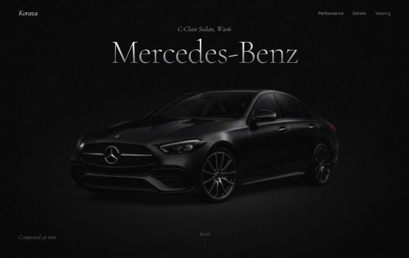
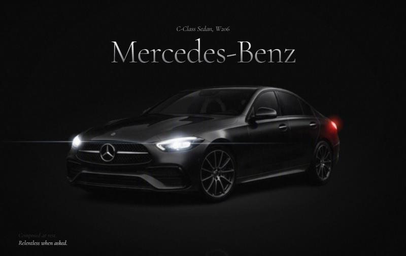
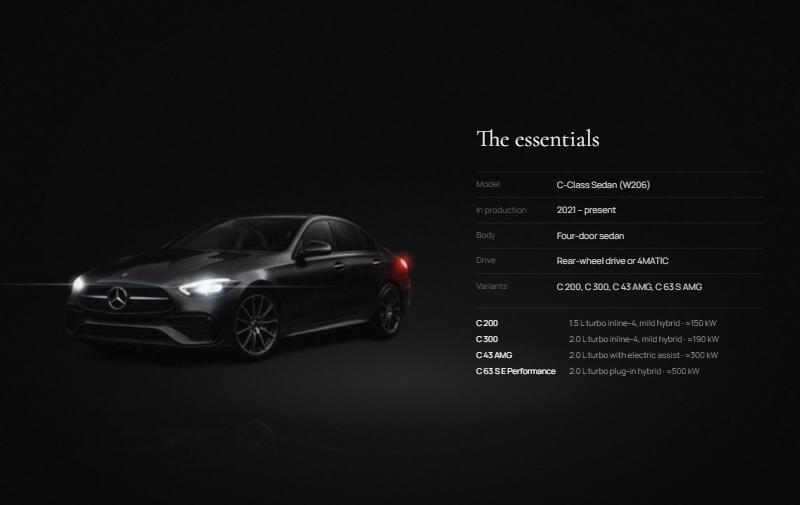
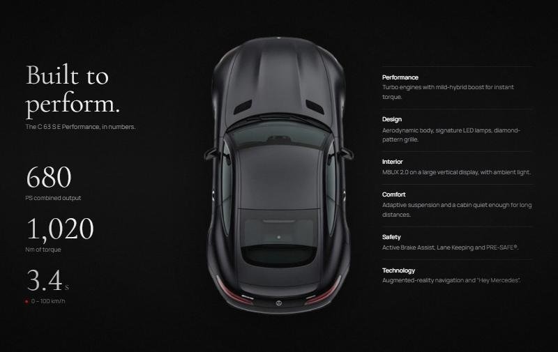
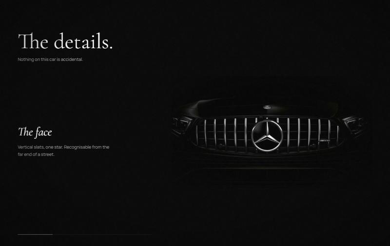
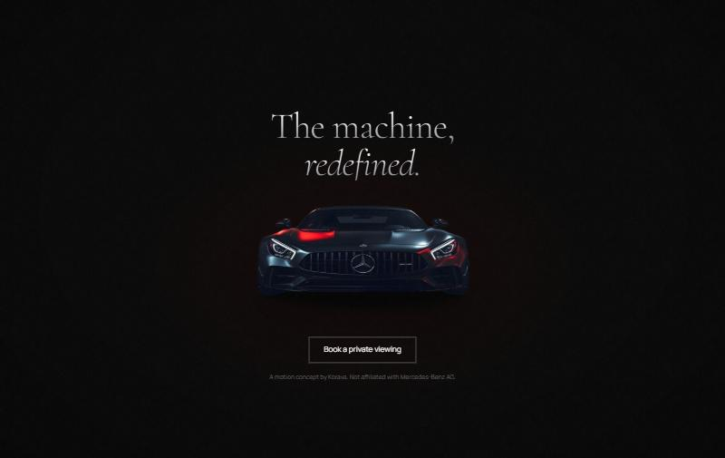

# Mercedes-Benz C-Class — a Korava motion concept

A scroll-driven product film for the Mercedes-Benz C-Class Sedan (W206), made to show what animation can do for a premium car launch:
the car arrives in the dark, its lamps wake, and every scroll reveals a little more of the machine.

**Live site: [korava-automotive.vercel.app](https://korava-automotive.vercel.app)**

> Independent concept work by Korava. Not commissioned by, or affiliated with, Mercedes-Benz AG.

| Arrival: lights out | A short scroll: ignition |
|---------------------|--------------------------|
|  |  |
| **The spec sheet** | **Built to perform** |
|  |  |
| **The details** | **The finale** |
|  |  |

## The sequence

1. **Ignition.** The car rises out of darkness with its lights out: *"Composed at rest."* A short scroll ignites the headlamps (two flickers, an anamorphic flare, the red tail lamp) and a studio light glides over the paint: *"Relentless when asked."* Scroll back and the lights go out again.
2. **The essentials.** The camera pulls back and the car glides into the left half; the spec sheet arrives beside it. The car's final position is measured from the sheet's real size, so the two never overlap at any zoom or font size.
3. **Built to perform.** The overhead car drives up into frame while 680 PS, 1,020 Nm and 3.4 s count up and the feature notes arrive, all on one scroll-driven timeline with the same start, length and easing.
4. **The details.** Eight close-ups, one at a time, each wiping up over the last with a slow push-in and a short caption.
5. **The finale.** A front portrait with red light breathing behind it, and a call to book a private viewing.

## How it's built

- **GSAP + ScrollTrigger** for the pinned and scrubbed scenes; **Lenis** for smooth scrolling.
- Only two scenes are pinned (the hero and the details). Performance uses scrub and layered parallax without pinning, so the page never feels stuck.
- The headlight ignition is a one-shot timeline that plays past a scroll threshold and reverses before it, rather than being scrubbed.
- The lights-off and lights-on photographs were cropped and aligned to the same canvas, so the ignition crossfade does not jump.
- A paint sheen is a moving gradient masked to the car's own silhouette (`mask-image` from the car PNG).
- Phones get a flowing layout with no pinning; `prefers-reduced-motion` gets the final states with no motion.

| Layer | Tech |
|-------|------|
| Page | Static HTML, CSS, vanilla JavaScript (no build step) |
| Motion | GSAP 3.12, ScrollTrigger, Lenis |
| Type | Cormorant Garamond, Manrope |
| Hosting | Vercel |

## Run locally

```bash
python serve.py
# open http://127.0.0.1:8080 (caching disabled while you edit)
```

Detail shots and captions are the `SHOTS` array at the top of `js/app.js`.
